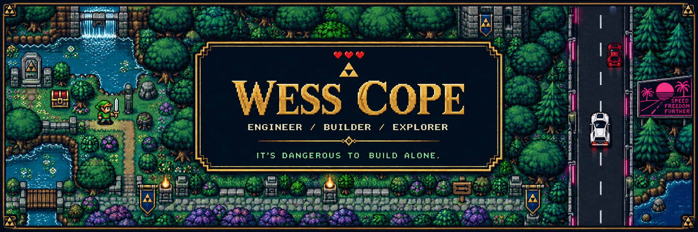
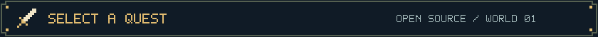
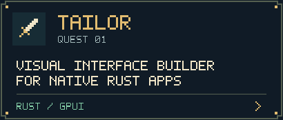
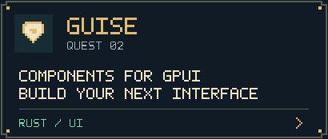
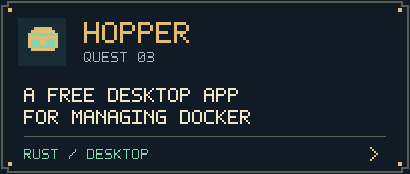
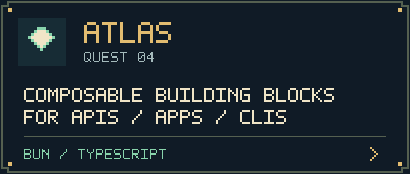
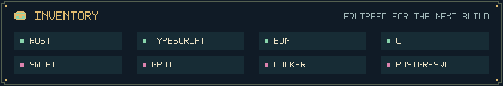
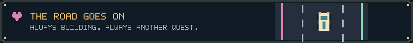

  

  <b>I suffer from Application Development Disorder.</b> 
  Native apps, developer tools, and things I wanted to exist. So I built them.

  <a href="https://wess.io">VISIT MY WORLD</a> &nbsp; / &nbsp;
  <a href="https://github.com/wess?tab=repositories">EXPLORE THE REPOS</a> &nbsp; / &nbsp;
  <a href="mailto:me@wess.io">SEND A MESSAGE</a>

  

  
  
   
  
  

  <picture>
    <source media="(max-width: 600px)" srcset="assets/inventorymobile.svg" />
    
  </picture>

  <a href="https://github.com/wess?tab=repositories">THERE ARE MORE QUESTS ON THE MAP →</a>

  

